# Major Component Selection

## Pressure Sensor

*Table 1: Pressure Sensor Selection*

| **Solution** | **Pros** | **Cons** |
| --- | --- | --- |
| 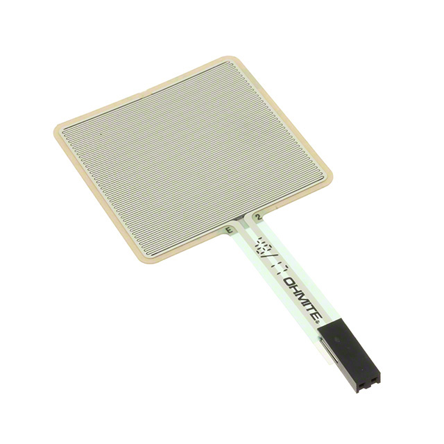 **Option 1** FSR01CE Ohmite Force Sensing Resistor [DigiKey Product Page](https://www.digikey.com/en/products/detail/ohmite/FSR01CE/9178296) | * Large sensing area is well suited for the pressure pad. * Thin construction makes it easy to install under the pressure surface. * Resistance output can be converted to voltage using a simple voltage divider. * Requires relatively little supporting circuitry. * Simple analog output is easy to interface with the signal-conditioning circuit. | * Resistance-to-force relationship is nonlinear. * Less accurate than precision force sensors such as load cells. * Output can vary depending on how force is distributed across the sensing area. * Calibration is required for accurate force measurements. |
| 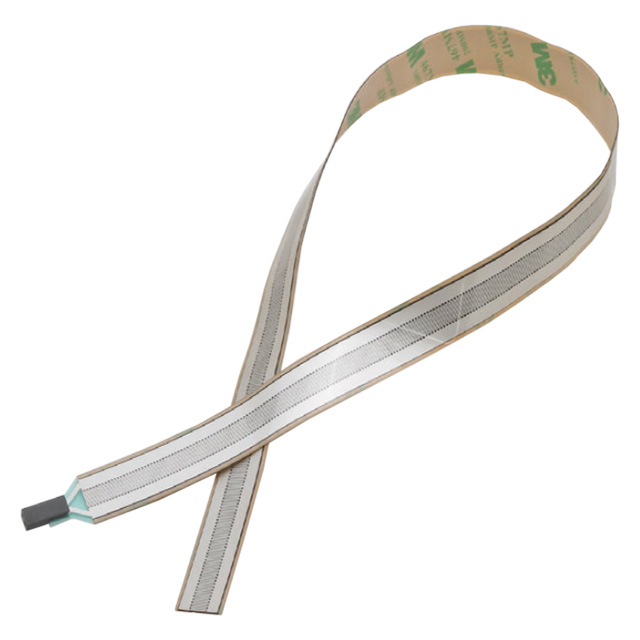 **Option 2** FSR02CE Ohmite Force Sensing Resistor [DigiKey Product Page](https://www.digikey.com/en/products/detail/ohmite/FSR02CE/9178297) | * Compact size requires little installation space. * Thin construction simplifies mechanical integration. * Resistance output allows simple analog signal conditioning. * Requires few supporting electrical components. | * Smaller sensing area is less suitable for the pressure pad. * Force must be concentrated over a smaller area. * Resistance-to-force relationship is nonlinear. * Requires calibration for accurate force measurements. |
| 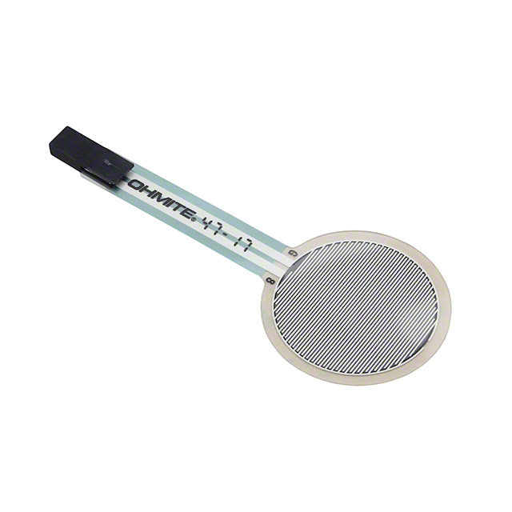 **Option 3** FSR03CE Ohmite Force Sensing Resistor [DigiKey Product Page](https://www.digikey.com/en/products/detail/ohmite/FSR03CE/9178298) | * Larger sensing area than the FSR02CE. * Thin construction allows installation underneath the pressure surface. * Resistance output is easy to interface with analog circuitry. * Requires relatively few supporting components. | * Sensing area is smaller than the FSR01CE. * Nonlinear response makes precise force measurements difficult. * Requires calibration for quantitative measurements. * Output can vary with force distribution. |

**Choice:** Option 1: FSR01CE

**Rationale:** The FSR01CE was selected because its larger sensing area is better suited for the pressure-pad subsystem. Its resistance-based output can be converted into a voltage using a simple voltage divider and conditioned before being measured by the microcontroller. The subsystem primarily needs to detect changes in applied pressure rather than make precision force measurements, making the FSR01CE a suitable combination of sensing area, simple interfacing, and mechanical integration.

---

## Operational Amplifier

*Table 2: Operational Amplifier Selection*

| **Solution** | **Pros** | **Cons** |
| --- | --- | --- |
| 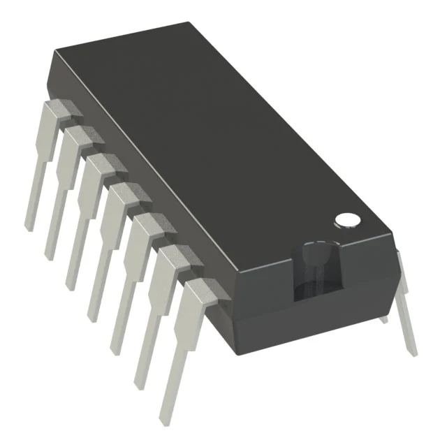 **Option 1** MCP6004-I/P Microchip Technology Quad Operational Amplifier 14-PDIP Through-Hole [DigiKey Product Page](https://www.digikey.com/en/products/detail/microchip-technology/MCP6004-I-P/523060) | * Operates from 1.8 V to 6 V and is compatible with the 5 V rail. * Rail-to-rail output provides a large usable output-voltage range. * Four operational amplifiers are included in one IC. * Low supply current reduces system power consumption. * Through-hole PDIP package is easy to solder. * Extra amplifier channels allow future expansion. | * 1 MHz gain-bandwidth product is lower than higher-performance alternatives. * Four amplifier channels may be more than currently required. * 14-pin package occupies more PCB space than an 8-pin dual amplifier. * Cannot operate directly from supply voltages greater than 6 V. |
| 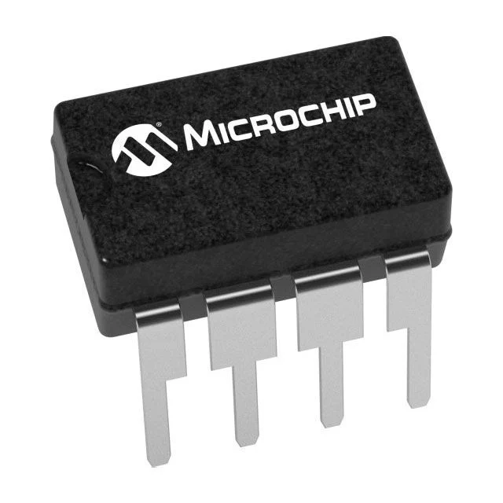 **Option 2** MCP6002-I/P Microchip Technology Dual Operational Amplifier 8-PDIP Through-Hole [DigiKey Product Page](https://www.digikey.com/en/products/detail/microchip-technology/MCP6002-I-P/500875) | * Operates from 1.8 V to 6 V and is compatible with the 5 V rail. * Rail-to-rail output is suitable for interfacing with the microcontroller ADC. * Smaller 8-pin package requires less PCB space. * Low supply current reduces system power consumption. * Through-hole package simplifies soldering and assembly. | * Contains only two amplifier channels compared with four in the MCP6004. * Future expansion could require an additional IC. * 1 MHz bandwidth is lower than higher-performance alternatives. * Provides fewer amplifier channels while offering similar electrical performance to the MCP6004. |
| 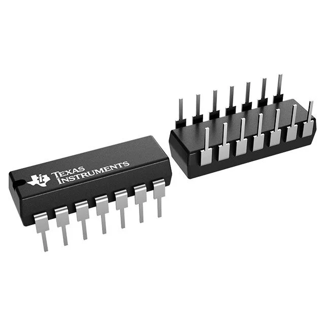 **Option 3** TLV2464IN Texas Instruments Quad Operational Amplifier 14-PDIP Through-Hole [DigiKey Product Page](https://www.digikey.com/en/products/detail/texas-instruments/TLV2464IN/374297) | * Contains four operational amplifiers in one package. * Compatible with the 5 V power rail. * Rail-to-rail output provides a large usable output range. * 6.4 MHz bandwidth provides greater performance than the MCP6004. * Through-hole package simplifies manual PCB assembly. | * More expensive than the MCP6004 and MCP6002. * Higher supply current increases system power consumption. * Additional bandwidth is unnecessary for the slowly changing pressure-pad signal. * 14-pin package provides no PCB-space advantage over the MCP6004. |

**Choice:** Option 1: MCP6004-I/P

**Rationale:** The MCP6004-I/P was selected because it provides four operational amplifiers, rail-to-rail output, low power consumption, and direct compatibility with the 5 V power rail. The MCP6002-I/P requires less PCB space but only provides two amplifier channels. The TLV2464IN provides greater bandwidth, but this additional performance is unnecessary for the relatively slow pressure-pad signal. The MCP6004-I/P therefore provides the required performance while also providing additional amplifier channels for future signal-conditioning requirements.

---

## 5 V Voltage Regulator

*Table 3: Voltage Regulator Selection*

| **Solution** | **Pros** | **Cons** |
| --- | --- | --- |
| 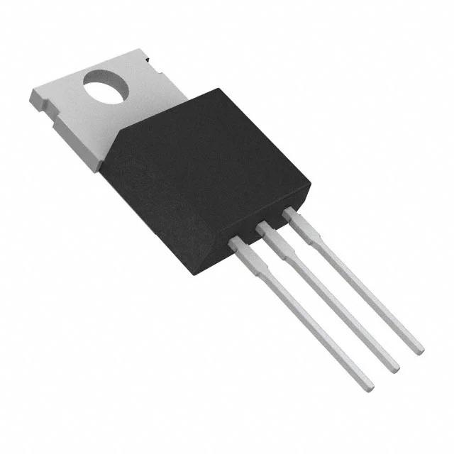 **Option 1** MC7805CTG onsemi 5 V Linear Voltage Regulator TO-220 Through-Hole [DigiKey Product Page](https://www.digikey.com/en/products/detail/onsemi/MC7805CTG/919333) | * Provides the regulated 5 V output required by the subsystem. * Through-hole TO-220 package simplifies manual soldering. * High output-current capability provides substantial current margin. * Common regulator architecture simplifies circuit implementation. * Internal protection features improve reliability. | * Excess input voltage is dissipated as heat. * Requires an input voltage sufficiently above 5 V to maintain regulation. * Efficiency decreases as the difference between input and output voltage increases. * Thermal management may be required at high load currents. |
| 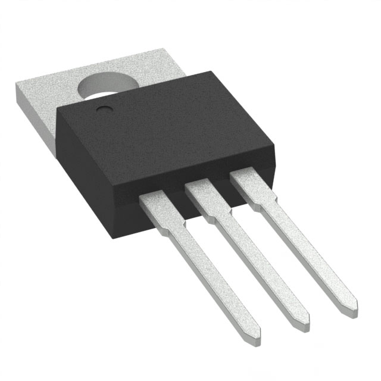 **Option 2** UA7805CKCS Texas Instruments 5 V Linear Voltage Regulator TO-220 Through-Hole [DigiKey Product Page](https://www.digikey.com/en/products/detail/texas-instruments/UA7805CKCS/521612) | * Fixed 5 V output directly matches the required power rail. * High output-current capability provides significant design margin. * Internal thermal protection improves reliability. * Internal current limiting provides protection during fault conditions. * Through-hole TO-220 package simplifies assembly. | * Linear regulation dissipates excess input voltage as heat. * Input voltage must remain sufficiently above 5 V. * Current capability is much greater than required by this subsystem. * Less efficient than a switching regulator when operating from a higher input voltage. |
|  **Option 3** LM2931T-5.0/NOPB Texas Instruments 5 V Low-Dropout Linear Regulator TO-220 Through-Hole [DigiKey Product Page](https://www.digikey.com/en/products/detail/texas-instruments/LM2931T-5-0-NOPB/28104) | * Fixed 5 V output matches the required system voltage. * Low-dropout design can operate with a lower input voltage than conventional 7805 regulators. * Through-hole TO-220 package simplifies manual soldering. * Lower dropout can reduce wasted voltage when the input supply is close to 5 V. | * Lower maximum output current than the 7805 alternatives. * Provides less current margin for future expansion. * Still dissipates excess input voltage as heat. * Output-current capability must be verified using the final power budget. |

**Choice:** Option 1: MC7805CTG

**Rationale:** The MC7805CTG was selected because it provides the required regulated 5 V output and sufficient current capacity for the pressure-pad subsystem while maintaining additional current margin. Its through-hole TO-220 package is appropriate for manual PCB assembly. The LM2931 provides lower dropout but has less output-current capability, while the UA7805CKCS provides more current capability than the subsystem requires. The MC7805CTG therefore provides a simple and robust solution when paired with an appropriate external DC supply.

---

## DC Barrel Jack

*Table 4: DC Barrel Jack Selection*

| **Solution** | **Pros** | **Cons** |
| --- | --- | --- |
| 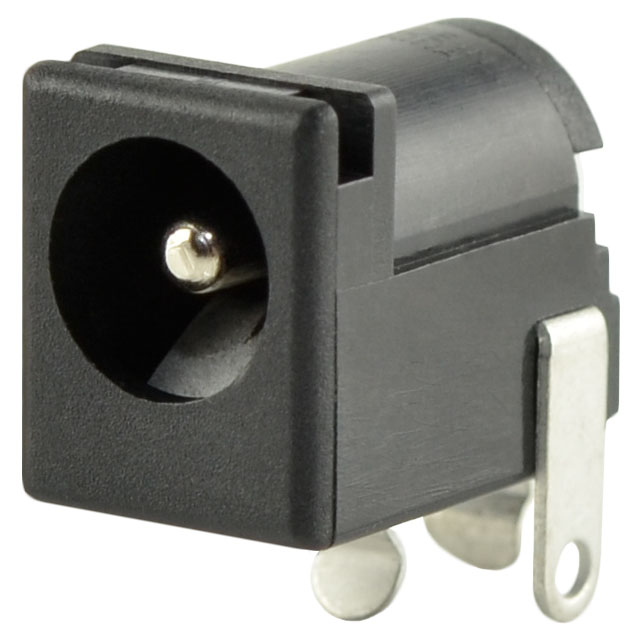 **Option 1** PJ-202A Same Sky 5.5 mm OD / 2.1 mm ID Through-Hole DC Barrel Jack [DigiKey Product Page](https://www.digikey.com/en/products/detail/same-sky-formerly-cui-devices/PJ-202A/252007) | * Through-hole mounting provides a strong mechanical PCB connection. * 5.5 mm by 2.1 mm size is suitable for commonly available DC adapters. * Right-angle orientation allows convenient access from the PCB edge. * Electrical ratings provide substantial margin for the subsystem. * Integrated switching contact provides additional power-routing flexibility. | * Occupies more PCB area than smaller power connectors. * Connecting and disconnecting the adapter applies mechanical force to the PCB. * External supply must use a compatible 5.5 mm by 2.1 mm plug. * Does not inherently protect against incorrect supply voltage or polarity. |
| 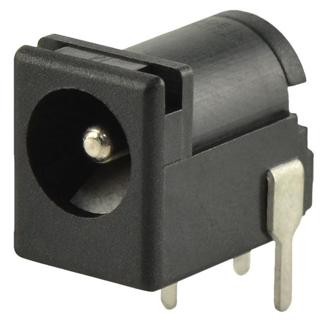 **Option 2** PJ-102A Same Sky 5.5 mm OD / 2.0 mm ID Through-Hole DC Barrel Jack [DigiKey Product Page](https://www.digikey.com/en/products/detail/same-sky-formerly-cui-devices/PJ-102A/275425) | * Through-hole mounting provides good mechanical strength. * Right-angle orientation is convenient for PCB-edge mounting. * Electrical ratings exceed the expected subsystem requirements. * Integrated switching contact provides additional power-routing options. | * 2.0 mm center pin is less compatible with common 2.1 mm plugs. * Requires a specifically matched external power adapter. * Occupies valuable PCB-edge space. * Does not protect the circuit from an incorrect supply voltage or polarity. |
| 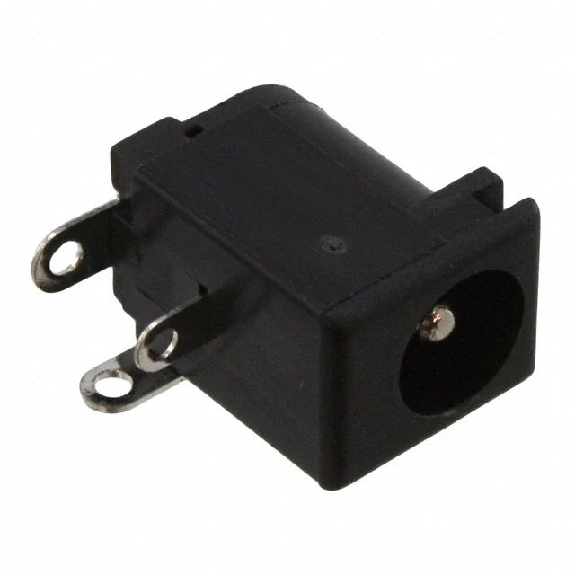 **Option 3** PJ-002A Same Sky 5.5 mm OD / 2.0 mm ID Through-Hole DC Barrel Jack [DigiKey Product Page](https://www.digikey.com/en/products/detail/same-sky-formerly-cui-devices/PJ-002A/96962) | * Through-hole construction provides good mechanical strength. * Electrical ratings provide substantial margin over the expected subsystem load. * Right-angle configuration allows convenient PCB-edge access. * Simple construction makes schematic integration straightforward. | * 2.0 mm center pin requires a matching external plug. * Less compatible with common 2.1 mm adapters than the PJ-202A. * Physical connector occupies significant PCB-edge space. * Does not provide protection against incorrect external supply voltage or polarity. |

**Choice:** Option 1: PJ-202A

**Rationale:** The PJ-202A was selected because its through-hole construction provides a strong mechanical connection to the PCB and its right-angle orientation allows convenient access from the edge of the board. Its 5.5 mm outer diameter and 2.1 mm center-pin configuration provides a practical connection for an external DC power adapter. Its electrical ratings also provide substantial margin over the requirements of the pressure-pad subsystem. Compared with the other two options, the PJ-202A provides the preferred 2.1 mm center-pin connection for the planned external power supply.