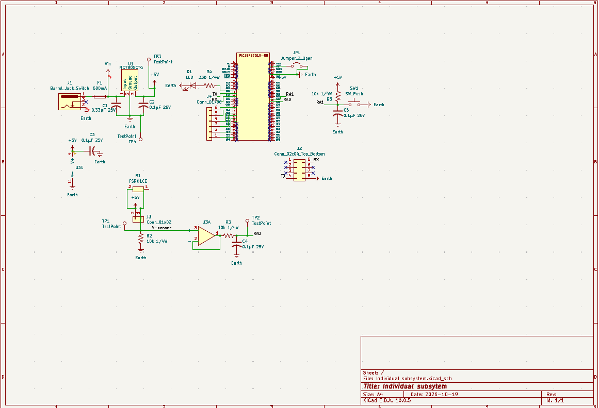

# Schematic

## Overview

This schematic is designed to support the pressure pad subsystem for the interactive cat toy. The FSR01CE pressure sensor detects applied pressure and produces a variable resistance that is converted into an analog voltage using a voltage divider. An MCP6004 operational amplifier buffers the sensor signal, which is then passed through a low-pass filter before being measured by the RA0 analog input of the PIC18F57Q43 Curiosity Nano.

The subsystem is powered from a 9–12 V DC input and uses an MC7805CTG linear voltage regulator to provide a regulated 5 V supply. The schematic also includes a debugging LED, a debounced pushbutton, test points, spare GPIO connections, and an 8-pin ribbon cable interface for communication with the other subsystems.

{style width:"700" height:"auto"}

**Figure 1:** Pressure pad subsystem schematic.

## Resources

The schematic as a PDF download is available [here](Individual%20subsystem.pdf), and the ZIP folder of the KiCad project is available [here](Individual%20subsystem.zip).