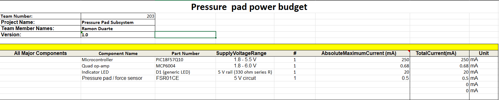
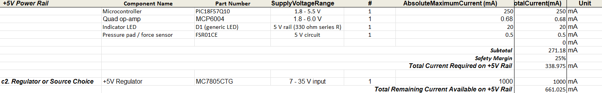
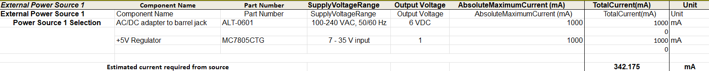

## Overview

A power budget was created for the pressure pad subsystem to determine the maximum current required by the electrical components. The subsystem uses an ALT-0601 AC/DC adapter with an output of 6 VDC at 1 A as its external power source.

The power budget includes the PIC18F57Q10 microcontroller, MCP6004 operational amplifier, FSR01CE pressure pad sensor, and indicator LED. A 25% safety margin was included to ensure sufficient current is available for the subsystem.

{style width:"900"}

{style width:"900"}

{style width:"900"}

## Conclusions

The completed power budget shows the expected power requirements of the pressure pad subsystem. The calculated current requirements, including the 25% safety margin, are within the available current capacity of the power source. The ALT-0601 AC/DC adapter provides 6 VDC at a maximum of 1 A, providing sufficient current for the subsystem.

## Resources

The completed power budget is available as a [PDF document](PowerBudget.pdf) and as a [Microsoft Excel spreadsheet](PowerBudget.xlsx).