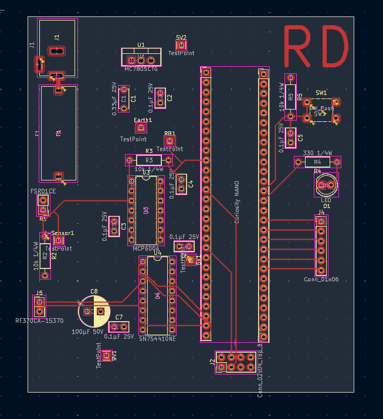
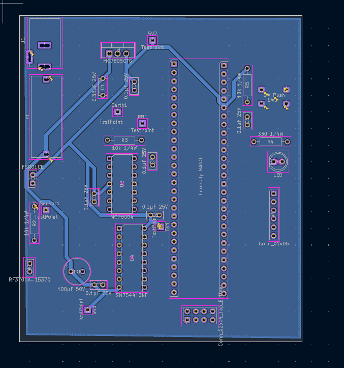

# PCB Design

## Overview

The PCB was designed in KiCad for the pressure pad subsystem. The board integrates the PIC18F57Q43 Curiosity Nano, pressure sensor circuitry, MCP6004 operational amplifier, 5 V voltage regulation, H-bridge motor control, debugging components, and subsystem connections.

The PCB uses both the front and back copper layers for routing. The bottom copper layer also contains an Earth ground plane. Power and ground traces were designed with increased trace widths to support the higher current requirements of the subsystem.

## Front PCB Layout

**Figure 1:** Front PCB layout.

## Back PCB Layout

**Figure 2:** Back PCB layout.

## Design Files

The complete KiCad PCB project is available [here](Individual%20subsystem.zip).

The Gerber and drill manufacturing files are available [here](Duarte203%20Gerber%20and%20Drill.zip).